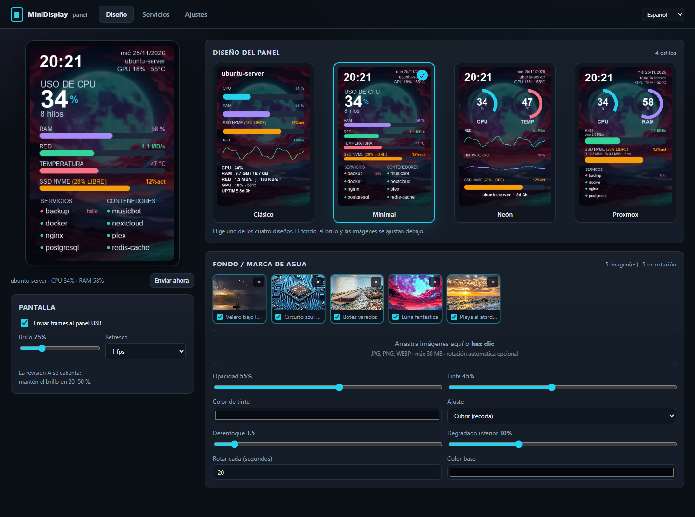
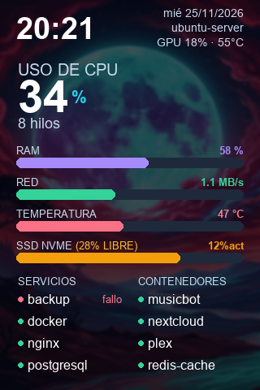
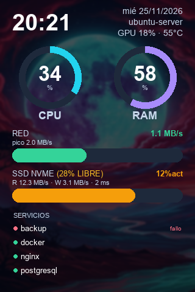
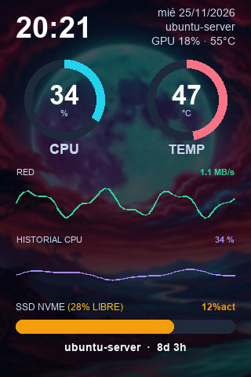
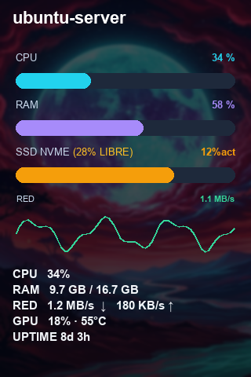
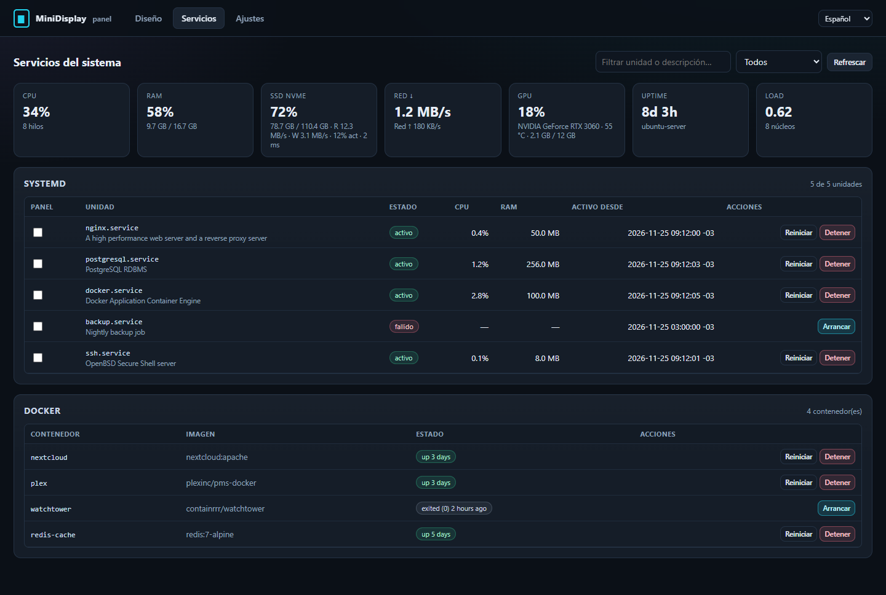

<p align="center">
  <a href="README.md">Español</a> ·
  <b>English</b> ·
  <a href="README.pt.md">Português</a> ·
  <a href="README.fr.md">Français</a> ·
  <a href="README.it.md">Italiano</a>
</p>

<h1 align="center">MiniDisplay Web</h1>

<p align="center">
  <b>Monitor your Linux server on a 3.5" USB display and manage it from your browser.</b><br>
  Four layouts, rotating backgrounds, CPU/RAM/GPU/disk metrics and service/container status.
</p>

<p align="center">
  
</p>

<p align="center">
  
  
  
</p>

---

## What it does

MiniDisplay Web turns a 3.5" USB display into a status panel for your server,
with no Windows-only software involved:

- **Four ready-made layouts** (Minimal, Proxmox, Neon and Classic) selected with
  a check from the web UI.
- **Decorative backgrounds**: upload several images, rotate them and adjust
  opacity, blur, tint and shading so the data stays readable.
- **Live metrics**: CPU, RAM, swap, GPU (usage, VRAM and temperature), disk
  (capacity, type, activity and I/O), network, temperature, load, processes,
  frequency, uptime, failed services and containers.
- **GPU only when present**: shown in the header, Classic and Services; it takes
  no space when there is no GPU.
- **Smart disk**: detects HDD/SSD/NVMe and shows the free percentage in colour
  (red <10%, yellow 10–30%, green >30%) next to its performance.
- **UI in 5 languages**: Spanish, English, Portuguese, French and Italian.
- **Proxmox-style view**: systemd and Docker status, CPU/RAM per service, and
  optional start/stop/restart actions.
- **Real-time preview** of the display inside the browser.
- **Starts on boot** with systemd and reconnects automatically if the USB cable
  is unplugged.
- Runs on **Ubuntu Server without a desktop environment**.

## The display

| Item | Value |
|---|---|
| Model | Turing Smart Screen **Rev A** / `UsbPCMonitor 3.5"` clone |
| USB | `1a86:5722` (WCH CH340 in CDC-ACM mode) |
| Serial number | `USB35INCHIPSV2` |
| Resolution | 320 × 480 (portrait), RGB565 |
| Driver | None: the kernel uses `cdc_acm` (`/dev/ttyACM0`) |

No drivers are required on Linux. The installer also creates a stable
`/dev/turing-screen` symlink and the permissions for the `dialout` group.

## Four layouts

| Minimal | Proxmox | Neon | Classic |
|:---:|:---:|:---:|:---:|
|  |  |  |  |
| CPU, RAM, network, temperature, disk and service/container columns (GPU in header) | CPU/RAM rings, network, disk with free space/activity and services | CPU/temperature rings, history charts and disk | Bars, network chart and summary with GPU |

A fresh installation starts with **Minimal**. The editor thumbnails are rendered
with your background and your current data. The disk shows its type
(HDD/SSD/NVMe) and free %; the GPU only appears when present.

## Web UI

- **Layout**: pick one of the four styles with a check.
- **Background**: gallery with multi-upload, rotation, opacity, blur, tint,
  shading and fit.
- **Display**: brightness (20–50% recommended) and refresh rate (0.5–3 fps).
- **Language**: ES/EN/PT/FR/IT selector in the header, saved per browser.
- **Services**: node summary, systemd table, Docker table and filters.
- **Settings**: diagnostics, config import/export and logs.

### Languages

The UI is available in **Spanish, English, Portuguese, French and Italian**. The
selector is in the header, the choice is saved per browser and the default is
Spanish.

### Services and containers



The **Panel** column lets you choose which units appear in the display's services
widget. Actions require installing with `--actions` (it creates a `sudoers` rule
limited to `systemctl` and `docker`).

## Default backgrounds

The project includes five **original images** generated for MiniDisplay Web in
`webapp/defaults/backgrounds/`:

- `velero-estrellas.jpg` — sailboat under the Milky Way.
- `circuito.jpg` — circuit board in blue and amber.
- `botes-playa.jpg` — boats stranded on a pebble beach.
- `luna-fantasia.jpg` — fantasy valley under a red moon.
- `playa-atardecer.jpg` — rocky beach at sunset.

On a fresh installation they are copied to
`/var/lib/minidisplay-web/backgrounds/` and enabled in the rotation. There is
nothing to upload and no third-party images are involved.

To ship more default backgrounds, drop them in that folder and update
`webapp/defaults/backgrounds.json` (or delete the JSON so every file is listed).

## Installation

### From GitHub

```bash
sudo apt update && sudo apt install -y git
git clone https://github.com/YOUR_USER/YOUR_REPO.git ~/driverMiniDisplay
cd ~/driverMiniDisplay/webapp
chmod +x install.sh
sudo ./install.sh --actions
```

Open `http://SERVER_IP:8080`. If you use a firewall:

```bash
sudo ufw allow 8080/tcp
```

When it finishes, **log out and back in** so your user picks up the `dialout`
group (or run `newgrp dialout`).

### What the installer does

1. Installs Python, `venv` and the system dependencies.
2. Copies the app to `/opt/minidisplay-web` and creates its virtualenv.
3. Prepares the data directory in `/var/lib/minidisplay-web`.
4. Creates the udev rule and the `/dev/turing-screen` symlink.
5. Disables `brltty` if present (it grabs CH340 chips).
6. Stops `turing-smart-screen` if it was running (both share the serial port).
7. Creates and starts the `minidisplay-web` service.

### Update

```bash
cd ~/driverMiniDisplay
git pull
sudo ./webapp/install.sh --actions
```

Configuration, backgrounds and logs in `/var/lib/minidisplay-web` are preserved.

### Classic monitor (optional)

The repository also includes `linux/install.sh`, the console monitor based on
`turing-smart-screen-python`. Do not run it together with the web panel: both
write to the same serial port.

## Usage

- `http://IP:8080/#design` — layout and background editor.
- `http://IP:8080/#services` — services and containers.
- `http://IP:8080/#settings` — diagnostics and logs.
- `http://IP:8080/?demo=1#services` — services view with sample data (useful for
  trying the UI without systemd/Docker).
- The header selector switches the UI between **ES/EN/PT/FR/IT**.

### Optional authentication

Edit `/etc/default/minidisplay-web`:

```ini
WEBAPP_USER=admin
WEBAPP_PASSWORD=a-long-password
```

and restart:

```bash
sudo systemctl restart minidisplay-web
```

## API

| Method | Route | Description |
|---|---|---|
| `GET` | `/api/config` | Current configuration |
| `PUT` | `/api/config` | Save configuration |
| `GET` | `/api/state` | Metrics + display status |
| `GET` | `/api/preview.png` | Current display frame |
| `POST` | `/api/display/push` | Force a push |
| `GET` | `/api/backgrounds` | Uploaded backgrounds |
| `POST` | `/api/backgrounds` | Upload backgrounds (`files`) |
| `DELETE` | `/api/backgrounds/<file>` | Delete a background |
| `GET` | `/api/services` | systemd + Docker |
| `POST` | `/api/services/action` | `{scope,name,action}` |
| `GET` | `/api/presets` | Available layouts |
| `POST` | `/api/presets/<name>` | Apply a layout |
| `GET` | `/api/presets/<name>/preview.png` | Layout thumbnail |
| `GET` | `/api/health` | Diagnostics |
| `GET` | `/api/logs?lines=150` | Latest log lines |

## Data and logs

| Path | Contents |
|---|---|
| `/opt/minidisplay-web` | Code and virtualenv |
| `/var/lib/minidisplay-web` | `config.json`, `backgrounds/`, `webapp.log` |
| `/etc/default/minidisplay-web` | Environment variables |
| `/etc/systemd/system/minidisplay-web.service` | systemd service |

```bash
systemctl status minidisplay-web
systemctl restart minidisplay-web
journalctl -u minidisplay-web -f
tail -f /var/lib/minidisplay-web/webapp.log
```

## Troubleshooting

**`/dev/turing-screen` does not appear**

```bash
lsusb | grep 1a86
dmesg | grep -i cdc_acm
sudo udevadm control --reload-rules && sudo udevadm trigger
```

Try another USB cable (many are charge-only) and a direct port, without a hub.

**The port exists but permissions are denied**

```bash
sudo usermod -aG dialout "$USER"   # Arch: uucp
# then log out and back in
```

**The display stays black or `brltty` grabs it**

```bash
sudo systemctl stop brltty-udev.service brltty.service
sudo systemctl mask brltty-udev.service brltty.service brltty@.service
# or remove it if you do not use a Braille reader:
sudo apt remove brltty
```

**The service does not start**

```bash
journalctl -u minidisplay-web -n 80
```

Make sure `minidisplay-web` is the only process using the serial port.

**The display disconnects by itself**

It is usually the cable or the USB port. The web app retries automatically; if
it does not come back, unplug the display for 10 seconds and reconnect it.

**It gets hot**

This is normal on revision A. Keep brightness between 20 and 50%.

**No temperature or GPU appears**

On Linux the CPU temperature comes from `hwmon`: install `lm-sensors` and run
`sensors-detect --auto`. NVIDIA is read with `nvidia-smi`; AMD with
`amdgpu`/sysfs. Intel iGPUs usually expose neither usage nor temperature. If the
GPU exists but provides no data, the panel shows `GPU n/d` and Services shows the
source. Generic Windows sensors are not available.

**The disk shows no activity or latency**

On Linux they are computed from `/proc/diskstats`; Windows lacks the I/O times,
so only capacity and read/write are shown. The type (HDD/SSD/NVMe) is detected
with `lsblk`/`sysfs`; inside a container it may show `STORAGE`.

**WSL**

WSL2 does not share the serial USB reliably. Use native Linux or a VM with the
USB device passed through.

## Structure

```
driverMiniDisplay/
├── minidisplay.py          # display driver and CLI (Linux/Windows/macOS)
├── linux/                  # classic console monitor (optional)
│   ├── install.sh
│   └── 99-turing-smart-screen.rules
├── webapp/                 # web panel
│   ├── app.py              # Flask: API and pages
│   ├── config.py           # settings, layouts and widgets
│   ├── collect.py          # metrics with psutil
│   ├── render.py           # 320x480 frame composition
│   ├── services.py         # systemd + Docker
│   ├── engine.py           # render thread
│   ├── display.py          # panel push thread
│   ├── templates/          # UI
│   ├── static/             # CSS, JS and i18n
│   ├── defaults/           # 5 original backgrounds
│   ├── requirements.txt
│   └── install.sh
├── docs/                   # README screenshots
├── README.md               # Spanish
├── README.en.md            # English
├── README.pt.md            # Portuguese
├── README.fr.md            # French
├── README.it.md            # Italian
└── LICENSE
```

## Development

```bash
cd webapp
python3 -m venv .venv
.venv/bin/pip install -r requirements.txt
.venv/bin/python app.py --no-display --port 8080
```

- `--no-display` starts only the web UI (no panel).
- `?demo=1` shows the services view with sample data.
- Quick panel tests: `python minidisplay.py --info`, `--test`.

## Author

Developed by **Fiso**.

## Credits

- The revision A protocol is documented by the community
  ([Hackaday](https://hackaday.com/2023/09/11/cheap-lcd-uses-usb-serial/),
  [CNX Software](https://www.cnx-software.com/2022/04/29/turing-smart-screen-a-low-cost-3-5-inch-usb-type-c-information-display/)).
- [`turing-smart-screen-python`](https://github.com/mathoudebine/turing-smart-screen-python)
  was used as a reference to validate the protocol; this project is an
  independent implementation.
- The five default backgrounds are original images generated for this project.

## License

MIT © 2026 Fiso. See [LICENSE](LICENSE).
