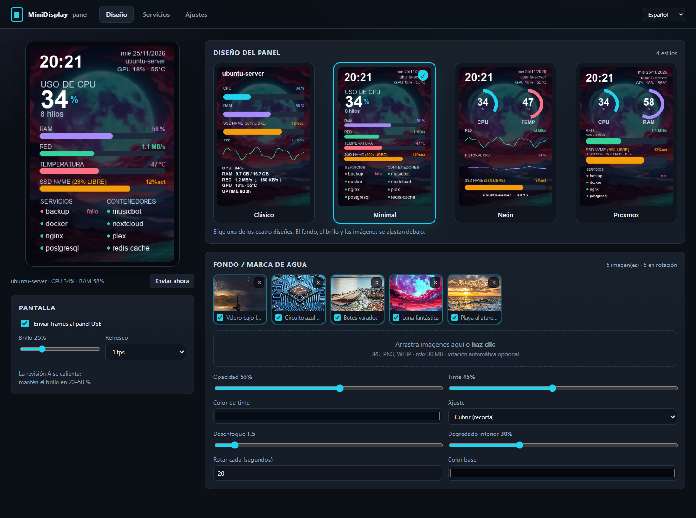
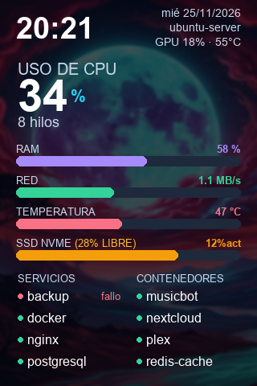
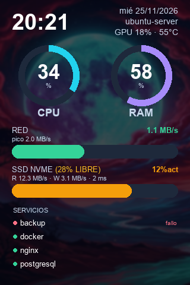
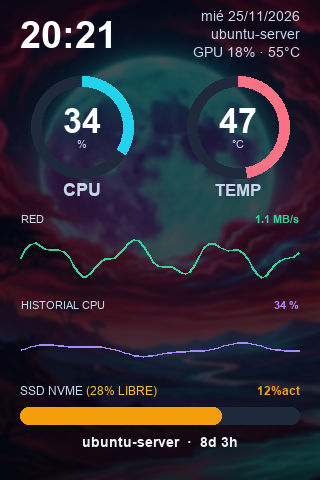
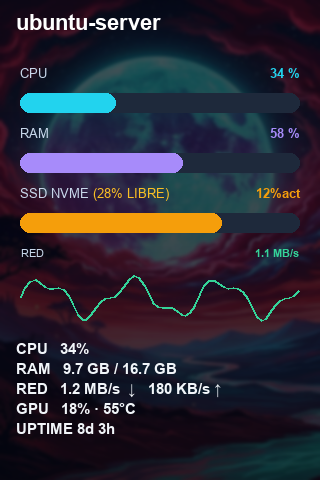
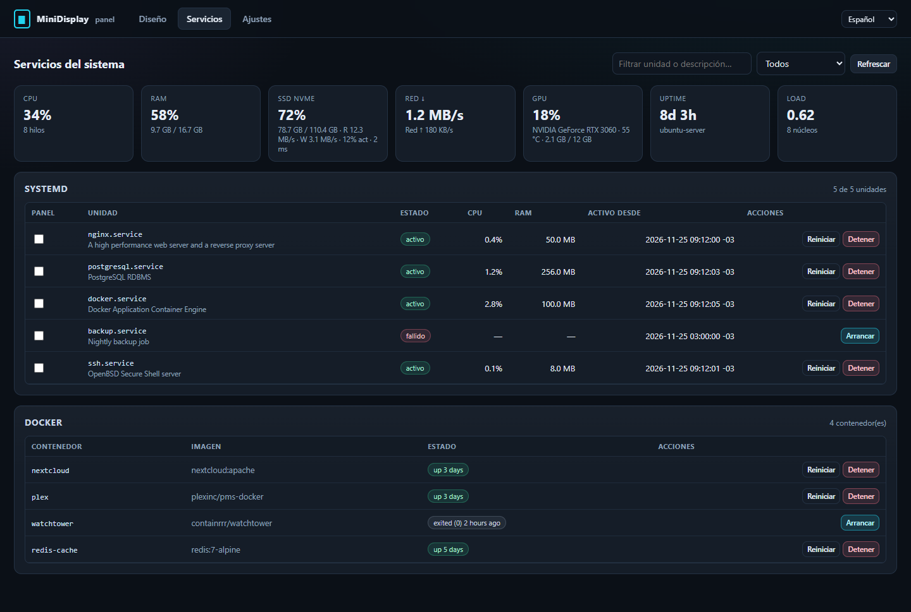

<p align="center">
  <a href="README.md">Español</a> ·
  <a href="README.en.md">English</a> ·
  <a href="README.pt.md">Português</a> ·
  <b>Français</b> ·
  <a href="README.it.md">Italiano</a>
</p>

<h1 align="center">MiniDisplay Web</h1>

<p align="center">
  <b>Surveillez votre serveur Linux sur un écran USB 3,5" et gérez-le depuis votre navigateur.</b><br>
  Quatre dispositions, arrière-plans rotatifs, métriques CPU/RAM/GPU/disque et état des services et conteneurs.
</p>

<p align="center">
  
</p>

<p align="center">
  
  
  
</p>

---

## Ce qu'il fait

MiniDisplay Web transforme un écran USB 3,5" en panneau d'état pour votre
serveur, sans dépendre d'un logiciel Windows :

- **Quatre dispositions** prêtes à l'emploi (Minimal, Proxmox, Neon et Classique),
  choisies avec une coche depuis l'interface web.
- **Arrière-plans décoratifs** : envoyez plusieurs images, activez la rotation et
  ajustez l'opacité, le flou, la teinte et le dégradé pour garder les données
  lisibles.
- **Métriques en direct** : CPU, RAM, swap, GPU (usage, VRAM et température),
  disque (capacité, type, activité et E/S), réseau, température, load, processus,
  fréquence, uptime, services en échec et conteneurs.
- **GPU uniquement s'il existe** : affichée dans l'en-tête, en Classique et dans
  Services ; sans GPU, elle n'occupe pas d'espace.
- **Disque intelligent** : détecte HDD/SSD/NVMe et affiche le % libre en couleur
  (rouge <10 %, jaune 10–30 %, vert >30 %) avec ses performances.
- **Interface en 5 langues** : espagnol, anglais, portugais, français et italien.
- **Vue type Proxmox** : état de systemd et Docker, CPU/RAM par service et
  actions optionnelles de démarrage, arrêt ou redémarrage.
- **Aperçu en temps réel** de l'écran dans le navigateur.
- **Démarrage automatique** avec systemd et reconnexion automatique si l'USB est
  débranché.
- Fonctionne sur **Ubuntu Server sans environnement graphique**.

## L'écran

| Élément | Valeur |
|---|---|
| Modèle | Turing Smart Screen **Rev A** / clone `UsbPCMonitor 3.5"` |
| USB | `1a86:5722` (WCH CH340 en mode CDC-ACM) |
| Numéro de série | `USB35INCHIPSV2` |
| Résolution | 320 × 480 (portrait), RGB565 |
| Pilote | Aucun : le noyau utilise `cdc_acm` (`/dev/ttyACM0`) |

Aucun pilote n'est nécessaire sous Linux. L'installateur crée aussi le lien
stable `/dev/turing-screen` et les permissions du groupe `dialout`.

## Quatre dispositions

| Minimal | Proxmox | Neon | Classique |
|:---:|:---:|:---:|:---:|
|  |  |  |  |
| CPU, RAM, réseau, température, disque et colonnes services/conteneurs (GPU dans l'en-tête) | Anneaux CPU/RAM, réseau, disque avec libre/activité et services | Anneaux CPU/température, historiques et disque | Barres, réseau et résumé avec GPU |

Une nouvelle installation démarre avec **Minimal**. Les miniatures de l'éditeur
sont générées avec votre arrière-plan et vos données actuelles. Le disque affiche
son type (HDD/SSD/NVMe) et le % libre ; la GPU n'apparaît que si elle existe.

## Panneau web

- **Disposition** : choisissez l'un des quatre styles avec une coche.
- **Arrière-plan** : galerie avec envoi multiple, rotation, opacité, flou,
  teinte, dégradé et cadrage.
- **Écran** : luminosité (20–50 % recommandé) et rafraîchissement (0,5–3 fps).
- **Langue** : sélecteur ES/EN/PT/FR/IT dans l'en-tête, mémorisé par navigateur.
- **Services** : résumé du nœud, tableau systemd, tableau Docker et filtres.
- **Réglages** : diagnostic, export/import de la configuration et journaux.

### Langues

L'interface est disponible en **espagnol, anglais, portugais, français et
italien**. Le sélecteur est dans l'en-tête, le choix est mémorisé par navigateur
et la langue par défaut est l'espagnol.

### Services et conteneurs



La colonne **Panneau** permet de choisir les unités affichées dans le widget de
services de l'écran. Les actions nécessitent une installation avec `--actions`
(cela crée une règle `sudoers` limitée à `systemctl` et `docker`).

## Arrière-plans par défaut

Le projet inclut cinq **images originales** générées pour MiniDisplay Web dans
`webapp/defaults/backgrounds/` :

- `velero-estrellas.jpg` — voilier sous la Voie lactée.
- `circuito.jpg` — carte de circuit imprimé bleue et ambre.
- `botes-playa.jpg` — bateaux échoués sur une plage de galets.
- `luna-fantasia.jpg` — vallée fantastique sous une lune rouge.
- `playa-atardecer.jpg` — plage rocheuse au coucher du soleil.

Lors d'une nouvelle installation, elles sont copiées dans
`/var/lib/minidisplay-web/backgrounds/` et activées dans la rotation. Rien à
envoyer et aucune image tierce n'est utilisée.

Pour ajouter d'autres arrière-plans par défaut, placez-les dans ce dossier et
mettez à jour `webapp/defaults/backgrounds.json` (ou supprimez le JSON pour
lister tous les fichiers).

## Installation

### Depuis GitHub

```bash
sudo apt update && sudo apt install -y git
git clone https://github.com/VOTRE_UTILISATEUR/VOTRE_DEPOT.git ~/driverMiniDisplay
cd ~/driverMiniDisplay/webapp
chmod +x install.sh
sudo ./install.sh --actions
```

Ouvrez `http://IP_DU_SERVEUR:8080`. Si un pare-feu est actif :

```bash
sudo ufw allow 8080/tcp
```

À la fin, **déconnectez-vous puis reconnectez-vous** pour que votre utilisateur
prenne le groupe `dialout` (ou exécutez `newgrp dialout`).

### Ce que fait l'installateur

1. Installe Python, `venv` et les dépendances système.
2. Copie l'application dans `/opt/minidisplay-web` et crée son environnement virtuel.
3. Prépare les données dans `/var/lib/minidisplay-web`.
4. Crée la règle udev et le lien `/dev/turing-screen`.
5. Désactive `brltty` s'il est présent (il accapare les puces CH340).
6. Arrête `turing-smart-screen` s'il tournait (ils partagent le port série).
7. Crée et démarre le service `minidisplay-web`.

### Mise à jour

```bash
cd ~/driverMiniDisplay
git pull
sudo ./webapp/install.sh --actions
```

La configuration, les arrière-plans et les journaux de
`/var/lib/minidisplay-web` sont conservés.

### Moniteur classique (optionnel)

Le dépôt inclut aussi `linux/install.sh`, le moniteur console basé sur
`turing-smart-screen-python`. Ne l'exécutez pas en même temps que le panneau web :
les deux écrivent sur le même port série.

## Utilisation

- `http://IP:8080/#design` — éditeur de disposition et d'arrière-plans.
- `http://IP:8080/#services` — services et conteneurs.
- `http://IP:8080/#settings` — diagnostic et journaux.
- `http://IP:8080/?demo=1#services` — vue des services avec des données
  d'exemple (utile pour tester l'interface sans systemd/Docker).
- Le sélecteur de l'en-tête change l'interface entre **ES/EN/PT/FR/IT**.

### Authentification optionnelle

Modifiez `/etc/default/minidisplay-web` :

```ini
WEBAPP_USER=admin
WEBAPP_PASSWORD=un-mot-de-passe-long
```

puis redémarrez :

```bash
sudo systemctl restart minidisplay-web
```

## API

| Méthode | Route | Description |
|---|---|---|
| `GET` | `/api/config` | Configuration actuelle |
| `PUT` | `/api/config` | Enregistrer la configuration |
| `GET` | `/api/state` | Métriques + état de l'écran |
| `GET` | `/api/preview.png` | Image actuelle de l'écran |
| `POST` | `/api/display/push` | Forcer l'envoi |
| `GET` | `/api/backgrounds` | Arrière-plans envoyés |
| `POST` | `/api/backgrounds` | Envoyer des arrière-plans (`files`) |
| `DELETE` | `/api/backgrounds/<fichier>` | Supprimer un arrière-plan |
| `GET` | `/api/services` | systemd + Docker |
| `POST` | `/api/services/action` | `{scope,name,action}` |
| `GET` | `/api/presets` | Dispositions disponibles |
| `POST` | `/api/presets/<nom>` | Appliquer une disposition |
| `GET` | `/api/presets/<nom>/preview.png` | Miniature d'une disposition |
| `GET` | `/api/health` | Diagnostic |
| `GET` | `/api/logs?lines=150` | Dernières lignes du journal |

## Données et journaux

| Chemin | Contenu |
|---|---|
| `/opt/minidisplay-web` | Code et environnement virtuel |
| `/var/lib/minidisplay-web` | `config.json`, `backgrounds/`, `webapp.log` |
| `/etc/default/minidisplay-web` | Variables d'environnement |
| `/etc/systemd/system/minidisplay-web.service` | Service systemd |

```bash
systemctl status minidisplay-web
systemctl restart minidisplay-web
journalctl -u minidisplay-web -f
tail -f /var/lib/minidisplay-web/webapp.log
```

## Dépannage

**`/dev/turing-screen` n'apparaît pas**

```bash
lsusb | grep 1a86
dmesg | grep -i cdc_acm
sudo udevadm control --reload-rules && sudo udevadm trigger
```

Essayez un autre câble USB (beaucoup ne font que charger) et un port direct, sans
hub.

**Le port existe mais les permissions manquent**

```bash
sudo usermod -aG dialout "$USER"   # Arch : uucp
# puis déconnexion / reconnexion
```

**L'écran reste noir ou `brltty` le bloque**

```bash
sudo systemctl stop brltty-udev.service brltty.service
sudo systemctl mask brltty-udev.service brltty.service brltty@.service
# ou supprimez-le si vous n'utilisez pas de lecteur Braille :
sudo apt remove brltty
```

**Le service ne démarre pas**

```bash
journalctl -u minidisplay-web -n 80
```

Vérifiez que `minidisplay-web` est le seul processus à utiliser le port série.

**L'écran se déconnecte tout seul**

C'est généralement le câble ou le port USB. L'interface web réessaie
automatiquement ; sinon, débranchez l'écran 10 secondes et rebranchez-le.

**Il chauffe**

C'est normal sur la révision A. Gardez la luminosité entre 20 et 50 %.

**La température ou la GPU n'apparaît pas**

Sous Linux, la température du CPU vient de `hwmon` : installez `lm-sensors` et
lancez `sensors-detect --auto`. NVIDIA se lit avec `nvidia-smi` ; AMD avec
`amdgpu`/sysfs. Les iGPU Intel n'exposent généralement ni usage ni température.
Si la GPU existe mais ne fournit pas de données, le panneau affiche `GPU n/d` et
Services indique la source. Les capteurs génériques de Windows ne sont pas
disponibles.

**Le disque n'affiche ni activité ni latence**

Sous Linux, elles sont calculées depuis `/proc/diskstats` ; sous Windows les
temps d'E/S manquent, donc seules la capacité et la lecture/écriture sont
affichées. Le type (HDD/SSD/NVMe) est détecté avec `lsblk`/`sysfs` ; dans un
conteneur, il peut afficher `STOCKAGE`.

**WSL**

WSL2 ne partage pas l'USB série de façon fiable. Utilisez Linux natif ou une VM
avec l'USB passé à la machine virtuelle.

## Structure

```
driverMiniDisplay/
├── minidisplay.py          # pilote et CLI de l'écran (Linux/Windows/macOS)
├── linux/                  # moniteur console classique (optionnel)
│   ├── install.sh
│   └── 99-turing-smart-screen.rules
├── webapp/                 # panneau web
│   ├── app.py              # Flask : API et pages
│   ├── config.py           # réglages, dispositions et widgets
│   ├── collect.py          # métriques avec psutil
│   ├── render.py           # composition de l'image 320x480
│   ├── services.py         # systemd + Docker
│   ├── engine.py           # thread de rendu
│   ├── display.py          # thread d'envoi vers l'écran
│   ├── templates/          # interface
│   ├── static/             # CSS, JS et i18n
│   ├── defaults/           # 5 arrière-plans originaux
│   ├── requirements.txt
│   └── install.sh
├── docs/                   # captures du README
├── README.md               # espagnol
├── README.en.md            # anglais
├── README.pt.md            # portugais
├── README.fr.md            # français
├── README.it.md            # italien
└── LICENSE
```

## Développement

```bash
cd webapp
python3 -m venv .venv
.venv/bin/pip install -r requirements.txt
.venv/bin/python app.py --no-display --port 8080
```

- `--no-display` lance uniquement l'interface web (sans l'écran).
- `?demo=1` affiche la vue des services avec des données d'exemple.
- Tests rapides de l'écran : `python minidisplay.py --info`, `--test`.

## Auteur

Développé par **Fiso**.

## Crédits

- Le protocole de la révision A est documenté par la communauté
  ([Hackaday](https://hackaday.com/2023/09/11/cheap-lcd-uses-usb-serial/),
  [CNX Software](https://www.cnx-software.com/2022/04/29/turing-smart-screen-a-low-cost-3-5-inch-usb-type-c-information-display/)).
- [`turing-smart-screen-python`](https://github.com/mathoudebine/turing-smart-screen-python)
  a servi de référence pour valider le protocole ; ce projet est une
  implémentation indépendante.
- Les cinq arrière-plans par défaut sont des images originales générées pour ce
  projet.

## Licence

MIT © 2026 Fiso. Voir [LICENSE](LICENSE).
