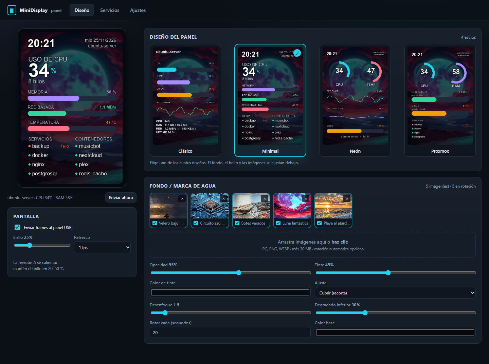
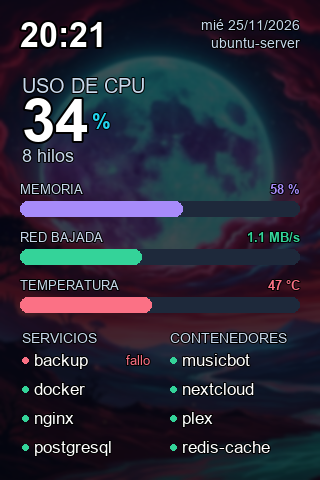
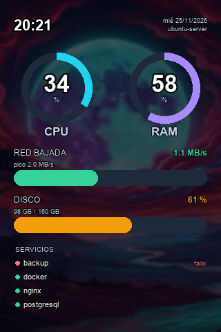
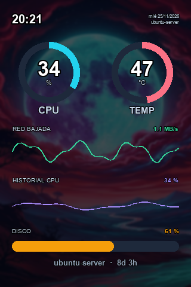
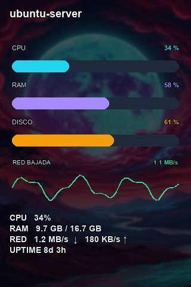
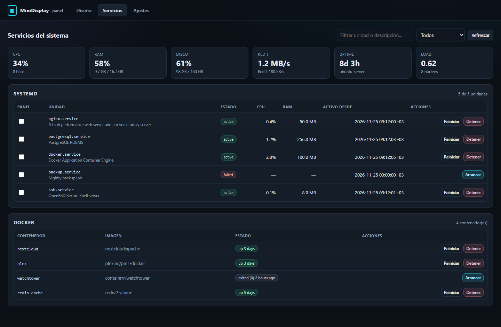

<p align="center">
  <a href="README.md">Español</a> ·
  <a href="README.en.md">English</a> ·
  <a href="README.pt.md">Português</a> ·
  <a href="README.fr.md">Français</a> ·
  <b>Italiano</b>
</p>

<h1 align="center">MiniDisplay Web</h1>

<p align="center">
  <b>Monitora il tuo server Linux su un display USB da 3,5" e gestiscilo dal browser.</b><br>
  Quattro layout, sfondi rotanti, metriche in tempo reale e stato di servizi e container.
</p>

<p align="center">
  
</p>

<p align="center">
  
  
  
</p>

---

## Cosa fa

MiniDisplay Web trasforma un display USB da 3,5" in un pannello di stato per il
tuo server, senza dipendere da software Windows:

- **Quattro layout** pronti (Minimal, Proxmox, Neon e Classico), scelti con una
  spunta dall'interfaccia web.
- **Sfondi decorativi**: carica più immagini, attiva la rotazione e regola
  opacità, sfocatura, tinta e sfumatura per mantenere i dati leggibili.
- **Metriche in tempo reale**: CPU, RAM, swap, disco, rete, temperatura, load,
  processi, frequenza, uptime, servizi in errore e container.
- **Vista stile Proxmox**: stato di systemd e Docker, CPU/RAM per servizio e
  azioni opzionali di avvio, arresto o riavvio.
- **Anteprima in tempo reale** del display nel browser.
- **Avvio automatico** con systemd e riconnessione automatica se l'USB si
  scollega.
- Funziona su **Ubuntu Server senza ambiente grafico**.

## Lo schermo

| Voce | Valore |
|---|---|
| Modello | Turing Smart Screen **Rev A** / clone `UsbPCMonitor 3.5"` |
| USB | `1a86:5722` (WCH CH340 in modalità CDC-ACM) |
| Numero di serie | `USB35INCHIPSV2` |
| Risoluzione | 320 × 480 (verticale), RGB565 |
| Driver | Nessuno: il kernel usa `cdc_acm` (`/dev/ttyACM0`) |

Su Linux non servono driver. L'installer crea anche il link stabile
`/dev/turing-screen` e i permessi per il gruppo `dialout`.

## Quattro layout

| Minimal | Proxmox | Neon | Classico |
|:---:|:---:|:---:|:---:|
|  |  |  |  |
| CPU, RAM, rete, temperatura e colonne servizi/container | Anelli CPU/RAM, rete, disco e lista servizi | Anelli CPU/temperatura e grafici storici | Barre, grafico di rete e riepilogo testuale |

Una nuova installazione parte con **Minimal**. Le miniature dell'editor sono
generate con il tuo sfondo e i dati attuali.

## Pannello web

- **Layout**: scegli uno dei quattro stili con una spunta.
- **Sfondo**: galleria con caricamento multiplo, rotazione, opacità, sfocatura,
  tinta, sfumatura e adattamento.
- **Schermo**: luminosità (20–50% consigliato) e aggiornamento (0,5–3 fps).
- **Servizi**: riepilogo del nodo, tabella systemd, tabella Docker e filtri.
- **Impostazioni**: diagnostica, esporta/importa configurazione e log.

### Servizi e container



Nella colonna **Pannello** scegli quali unità mostrare nel widget dei servizi sul
display. Le azioni richiedono l'installazione con `--actions` (crea una regola
`sudoers` limitata a `systemctl` e `docker`).

## Sfondi predefiniti

Il progetto include cinque **immagini originali** generate per MiniDisplay Web in
`webapp/defaults/backgrounds/`:

- `velero-estrellas.jpg` — veliero sotto la Via Lattea.
- `circuito.jpg` — scheda elettronica in blu e ambra.
- `botes-playa.jpg` — barche arenate su una spiaggia di sassi.
- `luna-fantasia.jpg` — valle fantastica sotto una luna rossa.
- `playa-atardecer.jpg` — spiaggia rocciosa al tramonto.

In una nuova installazione vengono copiate in
`/var/lib/minidisplay-web/backgrounds/` e attivate nella rotazione. Non serve
caricare nulla e non ci sono immagini di terze parti.

Per aggiungere altri sfondi predefiniti, inseriscili in quella cartella e
aggiorna `webapp/defaults/backgrounds.json` (oppure elimina il JSON per elencare
tutti i file).

## Installazione

### Da GitHub

```bash
sudo apt update && sudo apt install -y git
git clone https://github.com/TUO_UTENTE/TUO_REPO.git ~/driverMiniDisplay
cd ~/driverMiniDisplay/webapp
chmod +x install.sh
sudo ./install.sh --actions
```

Apri `http://IP_DEL_SERVER:8080`. Se usi un firewall:

```bash
sudo ufw allow 8080/tcp
```

Al termine, **esci e rientra** per ottenere il gruppo `dialout` (oppure esegui
`newgrp dialout`).

### Cosa fa l'installer

1. Installa Python, `venv` e le dipendenze di sistema.
2. Copia l'app in `/opt/minidisplay-web` e crea l'ambiente virtuale.
3. Prepara i dati in `/var/lib/minidisplay-web`.
4. Crea la regola udev e il link `/dev/turing-screen`.
5. Disattiva `brltty` se presente (occupa i chip CH340).
6. Ferma `turing-smart-screen` se era attivo (condividono la porta seriale).
7. Crea e avvia il servizio `minidisplay-web`.

### Aggiornamento

```bash
cd ~/driverMiniDisplay
git pull
sudo ./webapp/install.sh --actions
```

La configurazione, gli sfondi e i log in `/var/lib/minidisplay-web` vengono
conservati.

### Monitor classico (opzionale)

Il repository include anche `linux/install.sh`, il monitor da console basato su
`turing-smart-screen-python`. Non eseguirlo insieme al pannello web: entrambi
scrivono sulla stessa porta seriale.

## Utilizzo

- `http://IP:8080/#design` — editor di layout e sfondi.
- `http://IP:8080/#services` — servizi e container.
- `http://IP:8080/#settings` — diagnostica e log.
- `http://IP:8080/?demo=1#services` — vista servizi con dati di esempio (utile
  per provare l'interfaccia senza systemd/Docker).

### Autenticazione opzionale

Modifica `/etc/default/minidisplay-web`:

```ini
WEBAPP_USER=admin
WEBAPP_PASSWORD=una-password-lunga
```

e riavvia:

```bash
sudo systemctl restart minidisplay-web
```

## API

| Metodo | Percorso | Descrizione |
|---|---|---|
| `GET` | `/api/config` | Configurazione attuale |
| `PUT` | `/api/config` | Salva la configurazione |
| `GET` | `/api/state` | Metriche + stato del display |
| `GET` | `/api/preview.png` | Frame attuale del display |
| `POST` | `/api/display/push` | Forza l'invio |
| `GET` | `/api/backgrounds` | Sfondi caricati |
| `POST` | `/api/backgrounds` | Carica sfondi (`files`) |
| `DELETE` | `/api/backgrounds/<file>` | Elimina uno sfondo |
| `GET` | `/api/services` | systemd + Docker |
| `POST` | `/api/services/action` | `{scope,name,action}` |
| `GET` | `/api/presets` | Layout disponibili |
| `POST` | `/api/presets/<nome>` | Applica un layout |
| `GET` | `/api/presets/<nome>/preview.png` | Miniatura di un layout |
| `GET` | `/api/health` | Diagnostica |
| `GET` | `/api/logs?lines=150` | Ultime righe del log |

## Dati e log

| Percorso | Contenuto |
|---|---|
| `/opt/minidisplay-web` | Codice e ambiente virtuale |
| `/var/lib/minidisplay-web` | `config.json`, `backgrounds/`, `webapp.log` |
| `/etc/default/minidisplay-web` | Variabili d'ambiente |
| `/etc/systemd/system/minidisplay-web.service` | Servizio systemd |

```bash
systemctl status minidisplay-web
systemctl restart minidisplay-web
journalctl -u minidisplay-web -f
tail -f /var/lib/minidisplay-web/webapp.log
```

## Risoluzione dei problemi

**`/dev/turing-screen` non appare**

```bash
lsusb | grep 1a86
dmesg | grep -i cdc_acm
sudo udevadm control --reload-rules && sudo udevadm trigger
```

Prova un altro cavo USB (molti caricano soltanto) e una porta diretta, senza hub.

**La porta esiste ma mancano i permessi**

```bash
sudo usermod -aG dialout "$USER"   # Arch: uucp
# poi esci e rientra
```

**Il display resta nero o `brltty` lo blocca**

```bash
sudo systemctl stop brltty-udev.service brltty.service
sudo systemctl mask brltty-udev.service brltty.service brltty@.service
# oppure rimuovilo se non usi un lettore Braille:
sudo apt remove brltty
```

**Il servizio non parte**

```bash
journalctl -u minidisplay-web -n 80
```

Controlla che `minidisplay-web` sia l'unico processo sulla porta seriale.

**Il display si scollega da solo**

Di solito è il cavo o la porta USB. L'interfaccia web riprova automaticamente; se
non torna, scollega il display per 10 secondi e ricollegalo.

**Si scalda**

È normale nella revisione A. Tieni la luminosità tra 20 e 50%.

**WSL**

WSL2 non condivide l'USB seriale in modo affidabile. Usa Linux nativo o una VM con
l'USB passato alla macchina virtuale.

## Struttura

```
driverMiniDisplay/
├── minidisplay.py          # driver e CLI del display (Linux/Windows/macOS)
├── linux/                  # monitor classico da console (opzionale)
│   ├── install.sh
│   └── 99-turing-smart-screen.rules
├── webapp/                 # pannello web
│   ├── app.py              # Flask: API e pagine
│   ├── config.py           # impostazioni, layout e widget
│   ├── collect.py          # metriche con psutil
│   ├── render.py           # composizione del frame 320x480
│   ├── services.py         # systemd + Docker
│   ├── engine.py           # thread di rendering
│   ├── display.py          # thread di invio al display
│   ├── templates/          # interfaccia
│   ├── static/             # CSS e JS
│   ├── defaults/           # 5 sfondi originali
│   ├── requirements.txt
│   └── install.sh
├── docs/                   # screenshot del README
├── README.md               # spagnolo
├── README.en.md            # inglese
├── README.pt.md            # portoghese
├── README.fr.md            # francese
├── README.it.md            # italiano
└── LICENSE
```

## Sviluppo

```bash
cd webapp
python3 -m venv .venv
.venv/bin/pip install -r requirements.txt
.venv/bin/python app.py --no-display --port 8080
```

- `--no-display` avvia solo la web (senza display).
- `?demo=1` mostra la vista servizi con dati di esempio.
- Test rapidi del display: `python minidisplay.py --info`, `--test`.

## Autore

Sviluppato da **Fiso**.

## Crediti

- Il protocollo della revisione A è documentato dalla community
  ([Hackaday](https://hackaday.com/2023/09/11/cheap-lcd-uses-usb-serial/),
  [CNX Software](https://www.cnx-software.com/2022/04/29/turing-smart-screen-a-low-cost-3-5-inch-usb-type-c-information-display/)).
- [`turing-smart-screen-python`](https://github.com/mathoudebine/turing-smart-screen-python)
  è servito come riferimento per validare il protocollo; questo progetto è
  un'implementazione indipendente.
- I cinque sfondi predefiniti sono immagini originali generate per questo progetto.

## Licenza

MIT © 2026 Fiso. Vedi [LICENSE](LICENSE).
