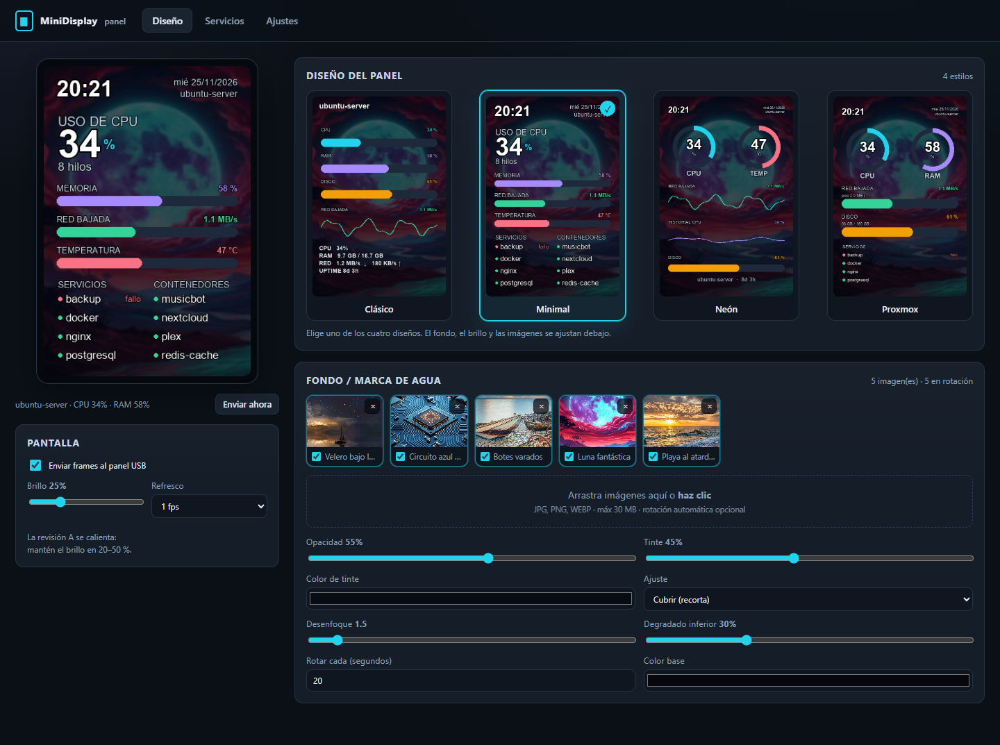
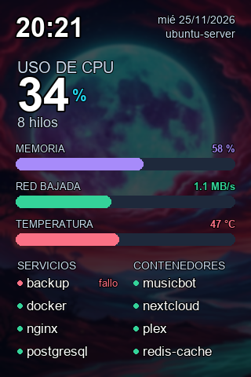
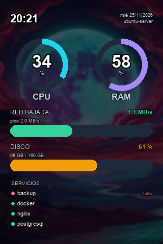
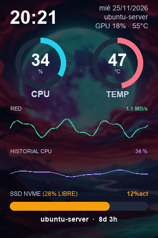
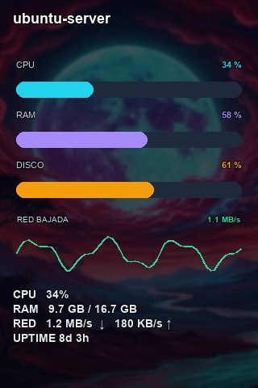
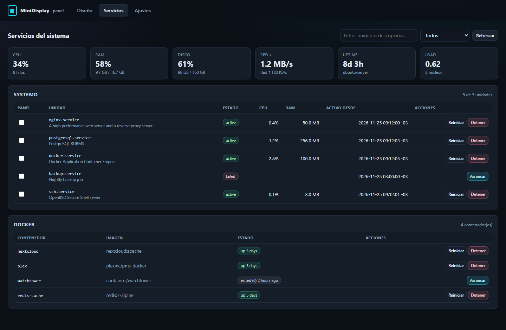

<p align="center">
  <b>Español</b> ·
  <a href="README.en.md">English</a> ·
  <a href="README.pt.md">Português</a> ·
  <a href="README.fr.md">Français</a> ·
  <a href="README.it.md">Italiano</a>
</p>

<h1 align="center">MiniDisplay Web</h1>

<p align="center">
  <b>Monitoriza tu servidor Linux en una pantalla USB de 3.5" y gestiónalo desde el navegador.</b><br>
  Cuatro diseños, fondos rotatorios, métricas de CPU/RAM/GPU/disco y estado de servicios y contenedores.
</p>

<p align="center">
  
</p>

<p align="center">
  
  
  
</p>

---

## Qué hace

MiniDisplay Web convierte una pantalla USB de 3.5" en un panel de estado para tu
servidor, sin depender de ningún programa de Windows:

- **Cuatro diseños** ya montados (Minimal, Proxmox, Neón y Clásico) que se
  eligen con un check desde la web.
- **Fondos decorativos**: sube varias imágenes, actívalas en rotación y ajusta
  opacidad, desenfoque, tinte y degradado para que los datos se lean bien.
- **Métricas en vivo**: CPU, RAM, swap, GPU (uso, VRAM y temperatura), disco
  (capacidad, tipo, actividad y E/S), red, temperatura, load, procesos,
  frecuencia, uptime, servicios con fallo y contenedores.
- **GPU solo si existe**: aparece en la cabecera, en Clásico y en Servicios; si
  no hay GPU no ocupa espacio.
- **Disco inteligente**: detecta HDD/SSD/NVMe y muestra el porcentaje libre con
  color (rojo <10 %, amarillo 10–30 %, verde >30 %) junto al rendimiento.
- **Interfaz en 5 idiomas**: español, inglés, portugués, francés e italiano.
- **Vista tipo Proxmox**: estado de systemd y Docker, CPU/RAM por servicio y
  acciones de arrancar, detener o reiniciar (opcionales).
- **Vista previa en tiempo real** del panel dentro del navegador.
- **Arranque automático** con systemd y reconexión automática si el USB se
  desconecta.
- Funciona en **Ubuntu Server sin entorno gráfico**.

## La pantalla

| Dato | Valor |
|---|---|
| Modelo | Turing Smart Screen **Rev A** / clon `UsbPCMonitor 3.5"` |
| USB | `1a86:5722` (WCH CH340 en modo CDC-ACM) |
| Número de serie | `USB35INCHIPSV2` |
| Resolución | 320 × 480 (vertical), RGB565 |
| Driver | Ninguno: el kernel usa `cdc_acm` (`/dev/ttyACM0`) |

En Linux no hay que instalar drivers. El instalador crea además un enlace
estable `/dev/turing-screen` y los permisos para el grupo `dialout`.

## Cuatro diseños

| Minimal | Proxmox | Neón | Clásico |
|:---:|:---:|:---:|:---:|
|  |  |  |  |
| CPU, RAM, red, temperatura, disco y columnas de servicios/contenedores (GPU en cabecera) | Anillos CPU/RAM, red, disco con libre/actividad y servicios | Anillos CPU/temperatura, históricos y disco | Barras, red y resumen con GPU |

Una instalación nueva arranca con **Minimal**. Las miniaturas del editor se
generan con tu fondo y tus datos actuales. El disco muestra su tipo
(HDD/SSD/NVMe) y el % libre; la GPU solo aparece cuando existe.

## Panel web

- **Diseño**: elige uno de los cuatro estilos con un check.
- **Fondo**: galería con subida múltiple, rotación, opacidad, desenfoque, tinte,
  degradado y encaje.
- **Pantalla**: brillo (20–50 % recomendado) y refresco (0.5–3 fps).
- **Idioma**: selector ES/EN/PT/FR/IT en la cabecera; se guarda en el navegador.
- **Servicios**: resumen del nodo, tabla de systemd, tabla de Docker y filtros.
- **Ajustes**: diagnóstico, exportar/importar configuración y logs.

### Idiomas

La interfaz está disponible en **español, inglés, portugués, francés e
italiano**. El selector está en la cabecera, la elección se guarda por navegador
y el idioma por defecto es español.

### Servicios y contenedores



Desde la columna **Panel** puedes elegir qué unidades aparecen en el widget de
servicios del display. Las acciones necesitan instalar con `--actions` (crea una
regla `sudoers` limitada a `systemctl` y `docker`).

## Fondos por defecto

El proyecto incluye cinco **imágenes originales** generadas para MiniDisplay Web
en `webapp/defaults/backgrounds/`:

- `velero-estrellas.jpg` — velero bajo la Vía Láctea.
- `circuito.jpg` — placa de circuito en azul y ámbar.
- `botes-playa.jpg` — botes varados en una playa de piedras.
- `luna-fantasia.jpg` — valle fantástico bajo una luna roja.
- `playa-atardecer.jpg` — playa rocosa al atardecer.

En una instalación nueva se copian solas a
`/var/lib/minidisplay-web/backgrounds/` y quedan activadas en la rotación. No hay
que subir nada y no dependen de imágenes de terceros.

Para añadir más fondos de serie, colócalos en esa carpeta y actualiza
`webapp/defaults/backgrounds.json` (o borra el JSON para que se listen todos).

## Instalación

### Desde GitHub

```bash
sudo apt update && sudo apt install -y git
git clone https://github.com/FisoFord/displayminiubuntu.git ~/driverMiniDisplay
cd ~/driverMiniDisplay/webapp
chmod +x install.sh
sudo ./install.sh --actions
```

Abre `http://IP_DEL_SERVIDOR:8080`. Si hay firewall:

```bash
sudo ufw allow 8080/tcp
```

Al terminar, **cierra sesión y vuelve a entrar** para tomar el grupo `dialout`
(o ejecuta `newgrp dialout`).

### Qué hace el instalador

1. Instala Python, `venv` y las dependencias del sistema.
2. Copia la aplicación a `/opt/minidisplay-web` y crea su entorno virtual.
3. Prepara los datos en `/var/lib/minidisplay-web`.
4. Crea la regla udev y el enlace `/dev/turing-screen`.
5. Desactiva `brltty` si está presente (se queda con los chips CH340).
6. Detiene `turing-smart-screen` si estaba activo (comparten el puerto serie).
7. Crea y arranca el servicio `minidisplay-web`.

### Actualizar

```bash
cd ~/driverMiniDisplay
git pull
sudo ./webapp/install.sh --actions
```

La configuración, los fondos y los logs de `/var/lib/minidisplay-web` se
conservan.

### Monitor clásico (opcional)

El repositorio incluye también `linux/install.sh`, el monitor de consola basado
en `turing-smart-screen-python`. No lo ejecutes a la vez que el panel web: ambos
escriben en el mismo puerto serie.

## Uso

- `http://IP:8080/#design` — editor de diseño y fondos.
- `http://IP:8080/#services` — servicios y contenedores.
- `http://IP:8080/#settings` — diagnóstico y logs.
- `http://IP:8080/?demo=1#services` — vista de servicios con datos de ejemplo
  (útil para probar la interfaz sin systemd/Docker).
- El selector de la cabecera cambia la interfaz entre **ES/EN/PT/FR/IT**.

### Autenticación opcional

Edita `/etc/default/minidisplay-web`:

```ini
WEBAPP_USER=admin
WEBAPP_PASSWORD=una-clave-larga
```

y reinicia:

```bash
sudo systemctl restart minidisplay-web
```

## API

| Método | Ruta | Descripción |
|---|---|---|
| `GET` | `/api/config` | Configuración actual |
| `PUT` | `/api/config` | Guardar configuración |
| `GET` | `/api/state` | Métricas + estado del panel |
| `GET` | `/api/preview.png` | Frame actual del panel |
| `POST` | `/api/display/push` | Forzar envío |
| `GET` | `/api/backgrounds` | Fondos subidos |
| `POST` | `/api/backgrounds` | Subir fondos (`files`) |
| `DELETE` | `/api/backgrounds/<archivo>` | Eliminar un fondo |
| `GET` | `/api/services` | systemd + Docker |
| `POST` | `/api/services/action` | `{scope,name,action}` |
| `GET` | `/api/presets` | Diseños disponibles |
| `POST` | `/api/presets/<nombre>` | Aplicar un diseño |
| `GET` | `/api/presets/<nombre>/preview.png` | Miniatura de un diseño |
| `GET` | `/api/health` | Diagnóstico |
| `GET` | `/api/logs?lines=150` | Últimas líneas del log |

## Datos y logs

| Ruta | Contenido |
|---|---|
| `/opt/minidisplay-web` | Código y entorno virtual |
| `/var/lib/minidisplay-web` | `config.json`, `backgrounds/`, `webapp.log` |
| `/etc/default/minidisplay-web` | Variables de entorno |
| `/etc/systemd/system/minidisplay-web.service` | Servicio systemd |

```bash
systemctl status minidisplay-web
systemctl restart minidisplay-web
journalctl -u minidisplay-web -f
tail -f /var/lib/minidisplay-web/webapp.log
```

## Solución de problemas

**No aparece `/dev/turing-screen`**

```bash
lsusb | grep 1a86
dmesg | grep -i cdc_acm
sudo udevadm control --reload-rules && sudo udevadm trigger
```

Prueba otro cable USB (muchos solo cargan) y un puerto directo, sin hub.

**El puerto existe pero no hay permisos**

```bash
sudo usermod -aG dialout "$USER"   # Arch: uucp
# y vuelve a iniciar sesión
```

**El panel se queda en negro o lo bloquea `brltty`**

```bash
sudo systemctl stop brltty-udev.service brltty.service
sudo systemctl mask brltty-udev.service brltty.service brltty@.service
# o desinstálalo si no usas lector Braille:
sudo apt remove brltty
```

**El servicio no arranca**

```bash
journalctl -u minidisplay-web -n 80
```

Comprueba que `minidisplay-web` es el único proceso usando el puerto serie.

**La pantalla se desconecta sola**

Suele ser el cable o el puerto USB. La web reintenta la conexión
automáticamente; si no vuelve, desenchufa el panel 10 segundos y reconéctalo.

**Se calienta**

Es normal en la revisión A. Mantén el brillo entre 20 y 50 %.

**No aparece la temperatura o la GPU**

En Linux la temperatura del CPU sale de `hwmon`: instala `lm-sensors` y ejecuta
`sensors-detect --auto`. NVIDIA se lee con `nvidia-smi`; AMD con `amdgpu`/sysfs.
Las iGPU Intel suelen no exponer uso ni temperatura. Si la GPU existe pero no da
datos, el panel muestra `GPU n/d` y Servicios indica la fuente. En Windows
genérico los sensores no están disponibles.

**El disco no muestra actividad o latencia**

En Linux se calculan desde `/proc/diskstats`; en Windows faltan los tiempos de
E/S y solo se muestran capacidad y lectura/escritura. El tipo (HDD/SSD/NVMe) se
detecta con `lsblk`/`sysfs`; dentro de un contenedor puede aparecer
`ALMACENAMIENTO`.

**WSL**

WSL2 no comparte el USB serie de forma fiable. Usa Linux nativo o una máquina
con el USB pasado a la VM.

## Estructura

```
driverMiniDisplay/
├── minidisplay.py          # driver y CLI del panel (Linux/Windows/macOS)
├── linux/                  # monitor clásico de consola (opcional)
│   ├── install.sh
│   └── 99-turing-smart-screen.rules
├── webapp/                 # panel web
│   ├── app.py              # Flask: API y páginas
│   ├── config.py           # ajustes, diseños y widgets
│   ├── collect.py          # métricas con psutil
│   ├── render.py           # composición del frame 320x480
│   ├── services.py         # systemd + Docker
│   ├── engine.py           # hilo de render
│   ├── display.py          # hilo de envío al panel
│   ├── templates/          # interfaz
│   ├── static/             # CSS, JS e i18n
│   ├── defaults/           # 5 fondos originales
│   ├── requirements.txt
│   └── install.sh
├── docs/                   # capturas del README
├── README.md               # español
├── README.en.md            # inglés
├── README.pt.md            # portugués
├── README.fr.md            # francés
├── README.it.md            # italiano
└── LICENSE
```

## Desarrollo

```bash
cd webapp
python3 -m venv .venv
.venv/bin/pip install -r requirements.txt
.venv/bin/python app.py --no-display --port 8080
```

- `--no-display` levanta solo la web (sin panel).
- `?demo=1` muestra la vista de servicios con datos de ejemplo.
- Los tests rápidos del panel: `python minidisplay.py --info`, `--test`.

## Autor

Desarrollado por **Fiso**.

## Créditos

- El protocolo de la revisión A está documentado por la comunidad
  ([Hackaday](https://hackaday.com/2023/09/11/cheap-lcd-uses-usb-serial/),
  [CNX Software](https://www.cnx-software.com/2022/04/29/turing-smart-screen-a-low-cost-3-5-inch-usb-type-c-information-display/)).
- [`turing-smart-screen-python`](https://github.com/mathoudebine/turing-smart-screen-python)
  sirvió como referencia para validar el protocolo; este proyecto es una
  implementación independiente.
- Los cinco fondos por defecto son imágenes originales generadas para este
  proyecto.

## Licencia

MIT © 2026 Fiso. Consulta [LICENSE](LICENSE).
