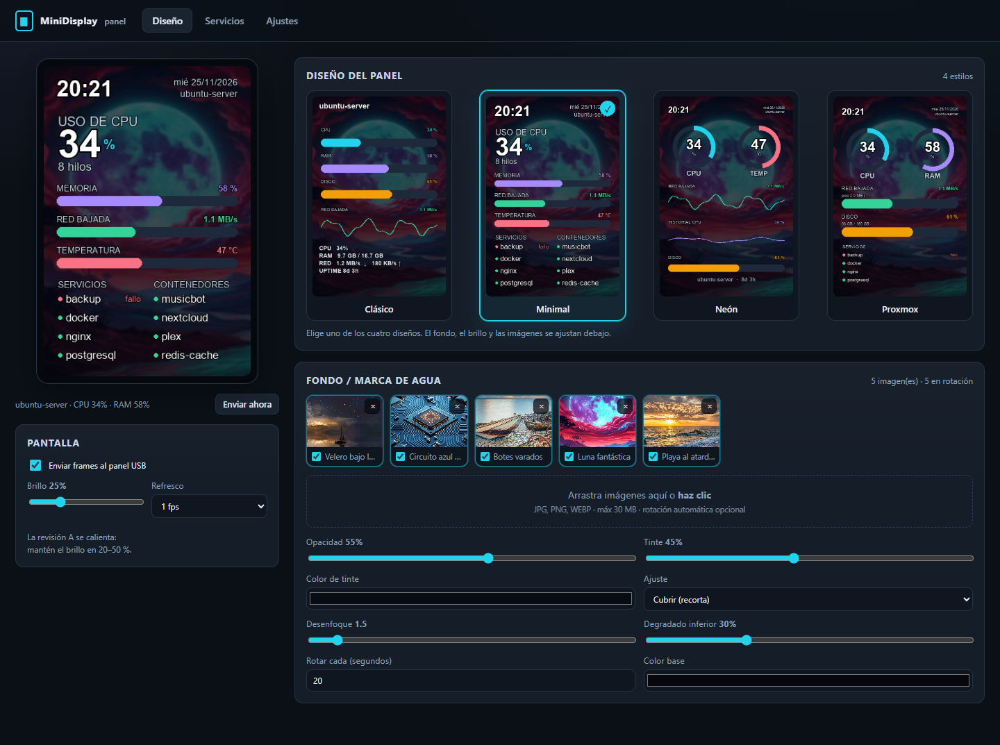
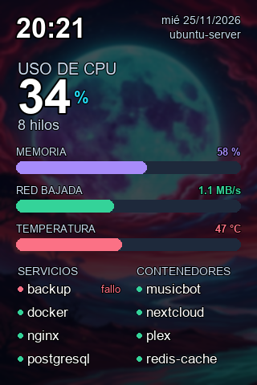
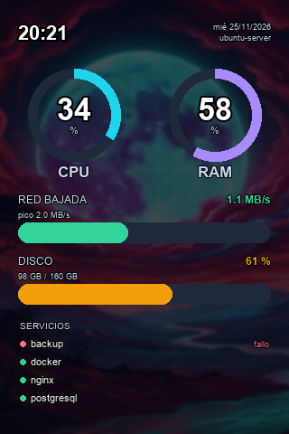
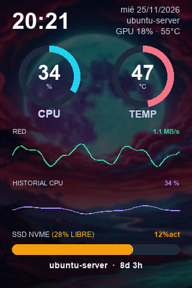
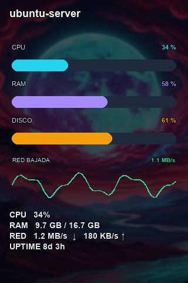
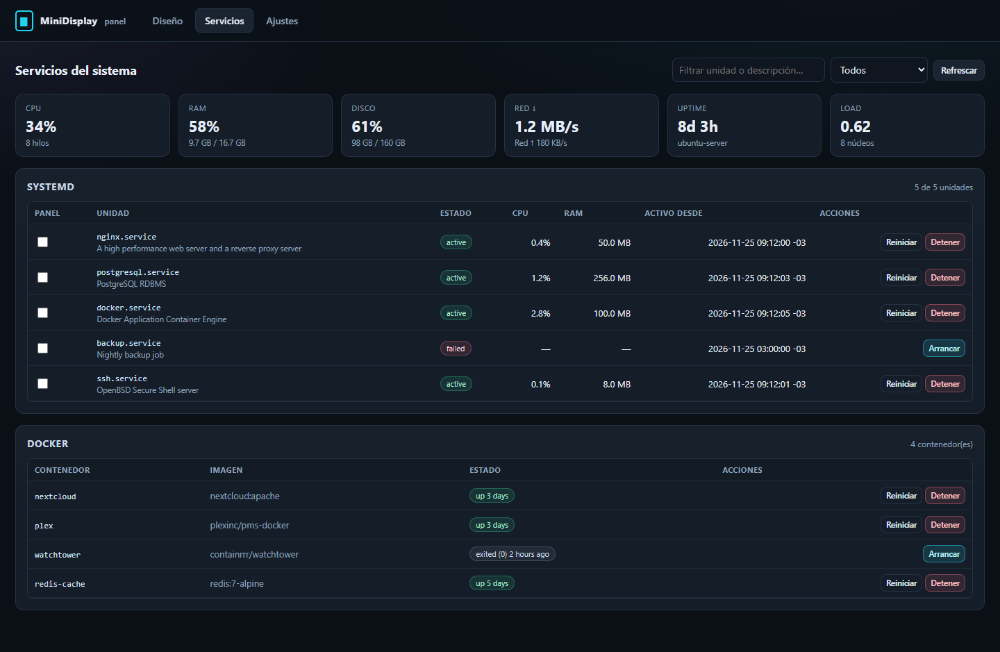

<p align="center">
  <a href="README.md">Español</a> ·
  <a href="README.en.md">English</a> ·
  <b>Português</b> ·
  <a href="README.fr.md">Français</a> ·
  <a href="README.it.md">Italiano</a>
</p>

<h1 align="center">MiniDisplay Web</h1>

<p align="center">
  <b>Monitore seu servidor Linux em uma tela USB de 3,5" e gerencie tudo pelo navegador.</b><br>
  Quatro layouts, fundos rotativos, métricas de CPU/RAM/GPU/disco e status de serviços e contêineres.
</p>

<p align="center">
  
</p>

<p align="center">
  
  
  
</p>

---

## O que faz

O MiniDisplay Web transforma uma tela USB de 3,5" em um painel de status para o
seu servidor, sem depender de nenhum programa exclusivo do Windows:

- **Quatro layouts** prontos (Minimal, Proxmox, Neon e Clássico), escolhidos com
  um check na interface web.
- **Fundos decorativos**: envie várias imagens, ative a rotação e ajuste
  opacidade, desfoque, tom e degradê para manter os dados legíveis.
- **Métricas ao vivo**: CPU, RAM, swap, GPU (uso, VRAM e temperatura), disco
  (capacidade, tipo, atividade e E/S), rede, temperatura, load, processos,
  frequência, uptime, serviços com falha e contêineres.
- **GPU só se existir**: aparece no cabeçalho, no Clássico e em Serviços; sem GPU
  não ocupa espaço.
- **Disco inteligente**: detecta HDD/SSD/NVMe e mostra a % livre com cor
  (vermelho <10%, amarelo 10–30%, verde >30%) junto ao desempenho.
- **Interface em 5 idiomas**: espanhol, inglês, português, francês e italiano.
- **Visão estilo Proxmox**: estado do systemd e do Docker, CPU/RAM por serviço e
  ações opcionais de iniciar, parar ou reiniciar.
- **Prévia em tempo real** da tela dentro do navegador.
- **Inicia com o sistema** via systemd e reconecta sozinho se o USB cair.
- Funciona no **Ubuntu Server sem ambiente gráfico**.

## A tela

| Item | Valor |
|---|---|
| Modelo | Turing Smart Screen **Rev A** / clone `UsbPCMonitor 3.5"` |
| USB | `1a86:5722` (WCH CH340 em modo CDC-ACM) |
| Número de série | `USB35INCHIPSV2` |
| Resolução | 320 × 480 (vertical), RGB565 |
| Driver | Nenhum: o kernel usa `cdc_acm` (`/dev/ttyACM0`) |

No Linux não é preciso instalar driver. O instalador também cria o link estável
`/dev/turing-screen` e as permissões para o grupo `dialout`.

## Quatro layouts

| Minimal | Proxmox | Neon | Clássico |
|:---:|:---:|:---:|:---:|
|  |  |  |  |
| CPU, RAM, rede, temperatura, disco e colunas de serviços/contêineres (GPU no cabeçalho) | Anéis CPU/RAM, rede, disco com livre/atividade e serviços | Anéis CPU/temperatura, históricos e disco | Barras, rede e resumo com GPU |

Uma instalação nova começa com o **Minimal**. As miniaturas do editor são geradas
com o seu fundo e os seus dados atuais. O disco mostra o tipo (HDD/SSD/NVMe) e a
% livre; a GPU só aparece quando existe.

## Painel web

- **Layout**: escolha um dos quatro estilos com um check.
- **Fundo**: galeria com envio múltiplo, rotação, opacidade, desfoque, tom,
  degradê e enquadramento.
- **Tela**: brilho (20–50% recomendado) e atualização (0,5–3 fps).
- **Idioma**: seletor ES/EN/PT/FR/IT no cabeçalho, salvo no navegador.
- **Serviços**: resumo do nó, tabela do systemd, tabela do Docker e filtros.
- **Ajustes**: diagnóstico, exportar/importar configuração e logs.

### Idiomas

A interface está disponível em **espanhol, inglês, português, francês e italiano**.
O seletor fica no cabeçalho, a escolha é salva por navegador e o padrão é espanhol.

### Serviços e contêineres



Na coluna **Painel** você escolhe quais unidades aparecem no widget de serviços da
tela. As ações exigem instalar com `--actions` (cria uma regra `sudoers` limitada
a `systemctl` e `docker`).

## Fundos padrão

O projeto inclui cinco **imagens originais** geradas para o MiniDisplay Web em
`webapp/defaults/backgrounds/`:

- `velero-estrellas.jpg` — veleiro sob a Via Láctea.
- `circuito.jpg` — placa de circuito em azul e âmbar.
- `botes-playa.jpg` — barcos encalhados em uma praia de pedras.
- `luna-fantasia.jpg` — vale fantástico sob uma lua vermelha.
- `playa-atardecer.jpg` — praia rochosa ao pôr do sol.

Em uma instalação nova elas são copiadas para
`/var/lib/minidisplay-web/backgrounds/` e ativadas na rotação. Não é preciso
enviar nada e não há imagens de terceiros.

Para incluir mais fundos padrão, coloque-os nessa pasta e atualize
`webapp/defaults/backgrounds.json` (ou apague o JSON para listar todos os
arquivos).

## Instalação

### Do GitHub

```bash
sudo apt update && sudo apt install -y git
git clone https://github.com/FisoFord/displayminiubuntu.git ~/driverMiniDisplay
cd ~/driverMiniDisplay/webapp
chmod +x install.sh
sudo ./install.sh --actions
```

Abra `http://IP_DO_SERVIDOR:8080`. Se houver firewall:

```bash
sudo ufw allow 8080/tcp
```

Ao terminar, **saia e entre novamente** para o seu usuário receber o grupo
`dialout` (ou execute `newgrp dialout`).

### O que o instalador faz

1. Instala Python, `venv` e as dependências do sistema.
2. Copia o aplicativo para `/opt/minidisplay-web` e cria o ambiente virtual.
3. Prepara os dados em `/var/lib/minidisplay-web`.
4. Cria a regra udev e o link `/dev/turing-screen`.
5. Desativa o `brltty` se estiver presente (ele toma os chips CH340).
6. Para o `turing-smart-screen` se estiver ativo (os dois usam a mesma porta serial).
7. Cria e inicia o serviço `minidisplay-web`.

### Atualizar

```bash
cd ~/driverMiniDisplay
git pull
sudo ./webapp/install.sh --actions
```

A configuração, os fundos e os logs em `/var/lib/minidisplay-web` são mantidos.

### Monitor clássico (opcional)

O repositório também inclui `linux/install.sh`, o monitor de console baseado no
`turing-smart-screen-python`. Não execute os dois ao mesmo tempo: ambos escrevem
na mesma porta serial.

## Uso

- `http://IP:8080/#design` — editor de layout e fundos.
- `http://IP:8080/#services` — serviços e contêineres.
- `http://IP:8080/#settings` — diagnóstico e logs.
- `http://IP:8080/?demo=1#services` — visão de serviços com dados de exemplo
  (útil para testar a interface sem systemd/Docker).
- O seletor do cabeçalho muda a interface entre **ES/EN/PT/FR/IT**.

### Autenticação opcional

Edite `/etc/default/minidisplay-web`:

```ini
WEBAPP_USER=admin
WEBAPP_PASSWORD=uma-senha-longa
```

e reinicie:

```bash
sudo systemctl restart minidisplay-web
```

## API

| Método | Rota | Descrição |
|---|---|---|
| `GET` | `/api/config` | Configuração atual |
| `PUT` | `/api/config` | Salvar configuração |
| `GET` | `/api/state` | Métricas + estado da tela |
| `GET` | `/api/preview.png` | Frame atual da tela |
| `POST` | `/api/display/push` | Forçar envio |
| `GET` | `/api/backgrounds` | Fundos enviados |
| `POST` | `/api/backgrounds` | Enviar fundos (`files`) |
| `DELETE` | `/api/backgrounds/<arquivo>` | Excluir um fundo |
| `GET` | `/api/services` | systemd + Docker |
| `POST` | `/api/services/action` | `{scope,name,action}` |
| `GET` | `/api/presets` | Layouts disponíveis |
| `POST` | `/api/presets/<nome>` | Aplicar um layout |
| `GET` | `/api/presets/<nome>/preview.png` | Miniatura de um layout |
| `GET` | `/api/health` | Diagnóstico |
| `GET` | `/api/logs?lines=150` | Últimas linhas do log |

## Dados e logs

| Caminho | Conteúdo |
|---|---|
| `/opt/minidisplay-web` | Código e ambiente virtual |
| `/var/lib/minidisplay-web` | `config.json`, `backgrounds/`, `webapp.log` |
| `/etc/default/minidisplay-web` | Variáveis de ambiente |
| `/etc/systemd/system/minidisplay-web.service` | Serviço systemd |

```bash
systemctl status minidisplay-web
systemctl restart minidisplay-web
journalctl -u minidisplay-web -f
tail -f /var/lib/minidisplay-web/webapp.log
```

## Solução de problemas

**`/dev/turing-screen` não aparece**

```bash
lsusb | grep 1a86
dmesg | grep -i cdc_acm
sudo udevadm control --reload-rules && sudo udevadm trigger
```

Teste outro cabo USB (muitos só carregam) e uma porta direta, sem hub.

**A porta existe, mas falta permissão**

```bash
sudo usermod -aG dialout "$USER"   # Arch: uucp
# depois saia e entre novamente
```

**A tela fica preta ou o `brltty` a bloqueia**

```bash
sudo systemctl stop brltty-udev.service brltty.service
sudo systemctl mask brltty-udev.service brltty.service brltty@.service
# ou remova se não usar leitor Braille:
sudo apt remove brltty
```

**O serviço não inicia**

```bash
journalctl -u minidisplay-web -n 80
```

Verifique se `minidisplay-web` é o único processo usando a porta serial.

**A tela desconecta sozinha**

Normalmente é o cabo ou a porta USB. A web tenta reconectar automaticamente; se
não voltar, desconecte a tela por 10 segundos e reconecte.

**Esquenta**

É normal na revisão A. Mantenha o brilho entre 20 e 50%.

**Não aparece a temperatura ou a GPU**

No Linux a temperatura do CPU vem do `hwmon`: instale `lm-sensors` e execute
`sensors-detect --auto`. NVIDIA usa `nvidia-smi`; AMD usa `amdgpu`/sysfs. As iGPU
Intel geralmente não expõem uso nem temperatura. Se a GPU existir mas não der
dados, o painel mostra `GPU n/d` e Serviços indica a fonte. Sensores genéricos do
Windows não estão disponíveis.

**O disco não mostra atividade ou latência**

No Linux são calculadas a partir de `/proc/diskstats`; no Windows faltam os
tempos de E/S e só aparecem capacidade e leitura/escrita. O tipo (HDD/SSD/NVMe) é
detectado com `lsblk`/`sysfs`; dentro de um contêiner pode aparecer
`ARMAZENAMENTO`.

**WSL**

O WSL2 não compartilha o USB serial de forma confiável. Use Linux nativo ou uma
VM com o USB passado para ela.

## Estrutura

```
driverMiniDisplay/
├── minidisplay.py          # driver e CLI da tela (Linux/Windows/macOS)
├── linux/                  # monitor clássico de console (opcional)
│   ├── install.sh
│   └── 99-turing-smart-screen.rules
├── webapp/                 # painel web
│   ├── app.py              # Flask: API e páginas
│   ├── config.py           # ajustes, layouts e widgets
│   ├── collect.py          # métricas com psutil
│   ├── render.py           # composição do frame 320x480
│   ├── services.py         # systemd + Docker
│   ├── engine.py           # thread de renderização
│   ├── display.py          # thread de envio para a tela
│   ├── templates/          # interface
│   ├── static/             # CSS, JS e i18n
│   ├── defaults/           # 5 fundos originais
│   ├── requirements.txt
│   └── install.sh
├── docs/                   # capturas do README
├── README.md               # espanhol
├── README.en.md            # inglês
├── README.pt.md            # português
├── README.fr.md            # francês
├── README.it.md            # italiano
└── LICENSE
```

## Desenvolvimento

```bash
cd webapp
python3 -m venv .venv
.venv/bin/pip install -r requirements.txt
.venv/bin/python app.py --no-display --port 8080
```

- `--no-display` inicia apenas a web (sem a tela).
- `?demo=1` mostra a visão de serviços com dados de exemplo.
- Testes rápidos da tela: `python minidisplay.py --info`, `--test`.

## Autor

Desenvolvido por **Fiso**.

## Créditos

- O protocolo da revisão A está documentado pela comunidade
  ([Hackaday](https://hackaday.com/2023/09/11/cheap-lcd-uses-usb-serial/),
  [CNX Software](https://www.cnx-software.com/2022/04/29/turing-smart-screen-a-low-cost-3-5-inch-usb-type-c-information-display/)).
- O [`turing-smart-screen-python`](https://github.com/mathoudebine/turing-smart-screen-python)
  serviu de referência para validar o protocolo; este projeto é uma implementação
  independente.
- Os cinco fundos padrão são imagens originais geradas para este projeto.

## Licença

MIT © 2026 Fiso. Consulte [LICENSE](LICENSE).
